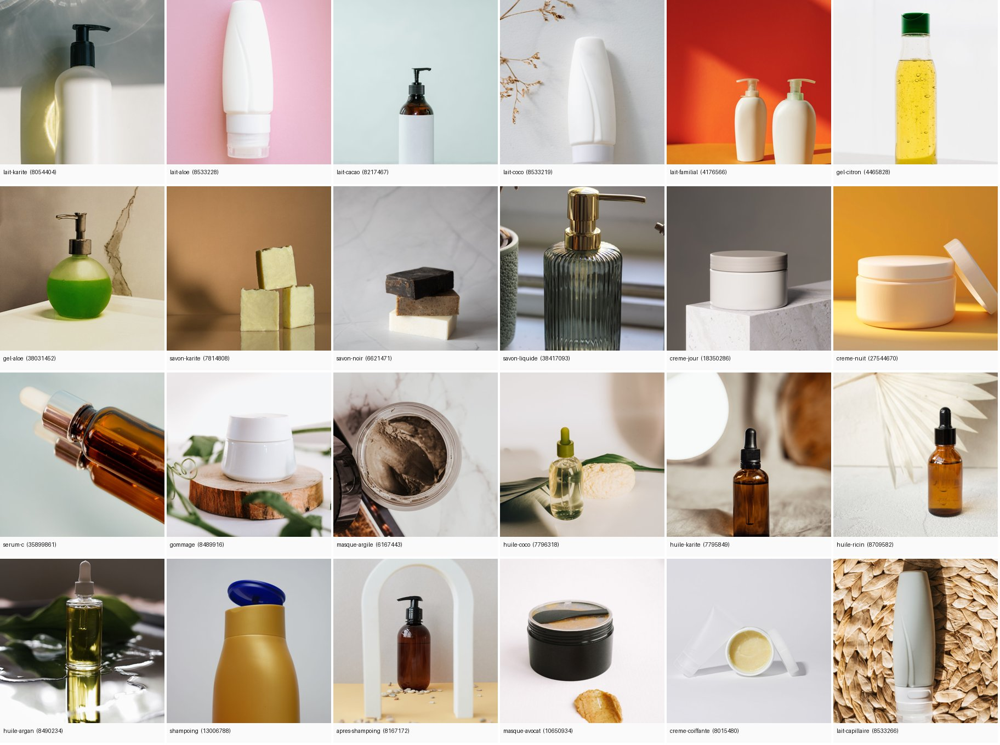
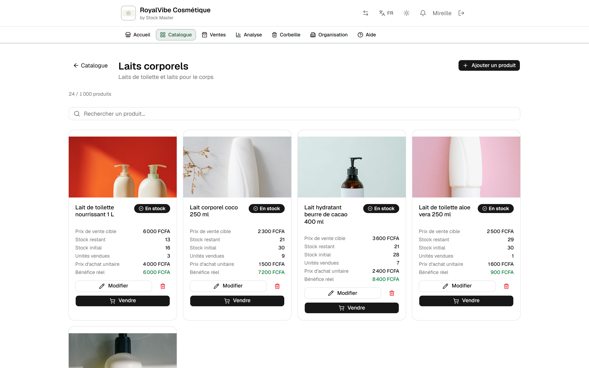
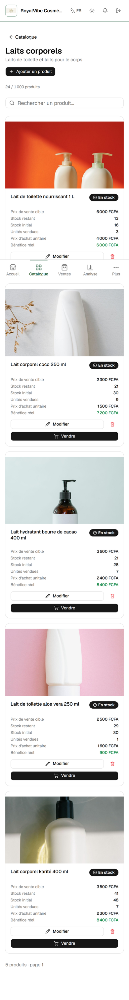
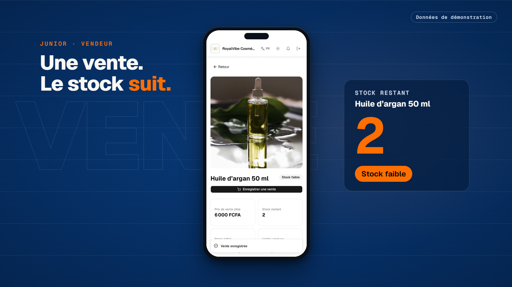
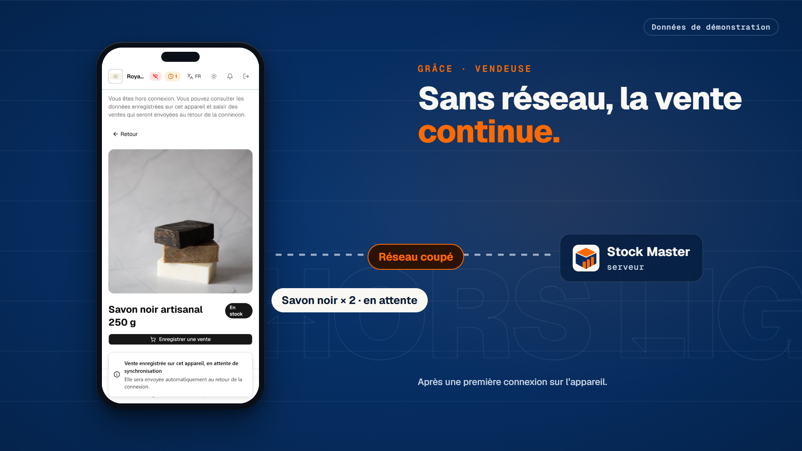
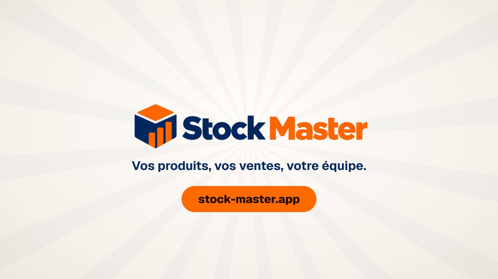

# Point de validation créative — lot 1-23A

Une seule validation avant l'animatique complet. Tout ce qui est montré ici vient de l'application
locale de démonstration (RoyalVibe Cosmétique, données fictives) ; rien n'a été rendu en vidéo.

## 1. Le catalogue de démonstration

- 5 rayons, 24 produits avec photo, prix en FCFA et stock ; 4 comptes (`@royalvibe.example.test`) :
  Mireille (propriétaire), Aïcha (administratrice), Junior (vendeur, droits « Ajuster le stock » et
  « Voir le détail du stock »), Grâce (vendeuse, droits du rôle).
- Historique : 115 ventes sur 13 jours (432 300 FCFA), enregistrées par l'API réelle avec leur date
  de vente ; abonnement annuel payé par le SasPay **simulé**.
- Tournage (actions réelles) : 1 vente de Junior, 1 droit ajouté à Grâce, 1 vente hors ligne de Grâce
  synchronisée une fois. Totaux affichés ensuite : **440 700 FCFA, 117 ventes, 140 unités**, identiques
  dans l'analyse, l'API, la base et l'export Excel.

| Planche des photos | Catalogue rempli (bureau) | Catalogue rempli (téléphone) |
|---|---|---|
|  |  |  |

Photos : Pexels, sans marque ni texte lisible, inventaire et licences dans `media/MEDIA-INVENTORY.md`.

## 2. Direction artistique recommandée : « Vitrine marine »

- **Fond** : marine Stock Master `#062B5C` en dégradé, filets horizontaux discrets qui évoquent des
  étagères, grain fixe. Deux respirations claires (papier `#F5F2EC`) : l'apparition du logo et l'analyse.
- **Couleur** : un seul accent, l'orange Stock Master `#FF6A00`, réservé à ce qui change (stock, envoi
  unique, appel à l'action). Le vert de RoyalVibe n'apparaît que dans l'application.
- **Typographie** : Geist (la police de l'application), très grasse pour les titres, Geist Mono pour
  les chiffres. Phrases de 2 à 6 mots, un mot en orange.
- **Grammaire reprise de la référence** (sans ses images ni ses textes) : téléphone au centre devant
  un mot géant en contour, panneaux d'ordinateur inclinés, alternance sombre/clair, fin logo + site.
- **Lisibilité sur téléphone** : l'écran réel reste au centre ; le chiffre utile est repris en très
  grand à côté (compteur, pastilles).
- **Composant nouveau** : le « fil de synchronisation » (le réseau coupe, la vente attend, le fil se
  referme, le paquet part une fois).
- Mention « Données de démonstration » sur chaque plan d'application.

## 3. Quatre images représentatives (composition HyperFrames réelle, captures réelles)

| | |
|---|---|
|  3,2 s · accroche |  29,5 s · la vente, stock 3 → 2 |
|  54,5 s · vente hors ligne en attente |  86 s · conclusion |

## 4. Storyboard des 90 secondes

`STORYBOARD.md` : 7 séquences (bénéfice, action réelle, texte à l'écran, voix off, transition,
durée), registre de 16 plans, audit de variété du kit sans avertissement.

| Temps | Séquence | Action réelle montrée |
|---|---|---|
| 0–8 s | Accroche | mur des 24 produits ; « Combien en reste-t-il ? Qui a vendu quoi ? » ; logo |
| 8–20 s | Produits | rayons → « Laits corporels » (photos, prix, stock) ; même rayon sur ordinateur |
| 20–35 s | Vente | Junior vend une huile d'argan : stock 3 → 2, « Stock faible » |
| 35–48 s | Équipe | notifications réelles chez Mireille ; droit « Voir le détail du stock » donné à Grâce |
| 48–63 s | Hors ligne | Grâce vend 2 savons sans réseau → en attente → envoyée une fois, stock 37 → 35 |
| 63–77 s | Activité | analyse (440 700 FCFA, produit à surveiller), ventes par jour, export Excel |
| 77–90 s | Conclusion | logo, « Vos produits, vos ventes, votre équipe. », `stock-master.app` |

## 5. Voix off et consignes Gemini TTS

- Texte : `voice/voiceover-fr.txt` (190 mots).
- Consignes : `voice/gemini-tts-direction-fr.md` (voix proposées Sulafat, Achird, Charon ; style ;
  une requête par scène avec `<short pause>` / `<long pause>` ; prononciation ; requête officielle).

## 6. Musique (présélection, à écouter)

Pistes Pixabay sans Content ID ni IA, fichiers dans `%LOCALAPPDATA%\StockMasterMotion23A\music-src\candidates\` :
1. « Afro House » — Artsiom Bialou (recommandée : couleur afro, assez neutre pour passer sous la voix)
2. « Corporate Calm Background » — Alexey Kazantsev (la plus discrète)
3. « Uplifting - Friend » — Easy_Eva (plus enjouée)

## Décisions attendues

1. Direction « Vitrine marine » et les quatre images : validées, ou corrections ?
2. Appel à l'action : `stock-master.app` seul, ou ajout de « Essai gratuit de 7 jours » ? À retenir
   **seulement si l'inscription publique sera ouverte** à la diffusion (défaut de production : fermée).
3. Musique : 1, 2 ou 3 ?
4. Le texte de voix off vous convient-il avant génération ?

## Décisions reçues (14 octobre 2026)

- Direction « Vitrine marine » conservée pour l'animatique.
- Musique provisoire : « Afro House » (Artsiom Bialou, Pixabay), nettement sous la voix.
- Appel à l'action : « Découvrez Stock Master » et `stock-master.app` bien visible ; aucune mention d'essai gratuit.
- Texte révisé avant génération : 165 mots recomptés ; passages allégés ; adresse parlée avec le tiret ;
  permission « voir toutes les ventes » (réellement attribuée à Grâce au tournage, rejoué) ; métrique
  « produits classés par montant vendu » ; condition de préparation du hors ligne affichée à l'écran.
- Voix : une prise complète d'abord, reprises par scène si nécessaire ; montage adapté à l'audio mesuré.
